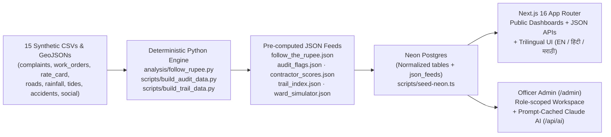
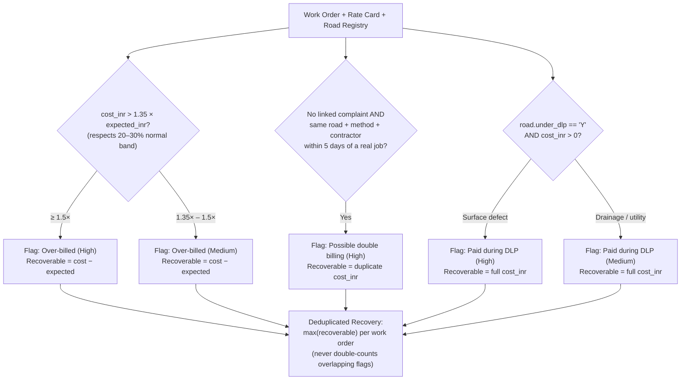
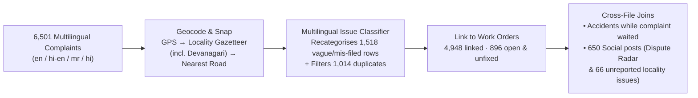

# Follow the Rupee — Mumbai Monsoon Road-Repair Audit & Next-Rupee Planner

> **Every monsoon rupee, followed from citizen complaint to road repair.**  
> Built in [`team41/`](file:///c:/Users/dmell/Desktop/claude-impact-lab/Project/claude-hackathon-2026/team41) using Next.js 16, React 19, Leaflet, Neon Postgres, Python analytics, and Claude.

> [!NOTE]
> **Synthetic Data Disclaimer:** This is an audit simulation built on 100% synthetic hackathon data (`team41/data/`). All contractors, work orders, complaints, social posts, and recovery notices are fictional and exist solely to demonstrate the audit workflow.

---

## At a Glance (Citywide Audit Snapshot)

| Metric | Value | What It Means |
|---|---:|---|
| **Wards & Road Segments** | **24 wards** | Full Mumbai BMC ward coverage with GeoJSON boundaries & Voronoi approximations |
| **Monsoon Spend vs. Budget** | **₹13.43 cr / ₹14.91 cr** | Across **2,499** repair work orders and **8** empanelled contractors |
| **Flagged Work Orders** | **623 jobs (₹3.77 cr)** | **493** Paid during DLP · **113** Over-billed · **45** Possible double billing |
| **30-Day Failed Fixes** | **611 jobs (₹3.07 cr)** | Repairs that reopened within 30 days of completion |
| **Citizen Complaints** | **6,501** | Multilingual (`en`, `hi-en`, `mr`, `hi`) — **4,948** linked to WOs, **896** open & unfixed, **1,014** duplicates |
| **Social Signal Radar** | **650 posts** | X, WhatsApp & Instagram — **66** unreported issues matched to localities |

---

## System Architecture & Data Flow

Deterministic Python rules compute every audit flag, fairness baseline, complaint link, and risk score **before** the UI or Claude ever sees a number. Claude explains and prioritises on top of verified math — never inventing figures.



---

## How We Meet Every Judging Criterion

### 1. Audit Accuracy (25%) — *Catches real problems, not normal variation*

Normal monsoon repairs vary **20–30%** around standard government rates. Instead of flagging noisy edge cases, our audit engine ([`analysis/follow_rupee.py`](file:///c:/Users/dmell/Desktop/claude-impact-lab/Project/claude-hackathon-2026/team41/analysis/follow_rupee.py) & [`scripts/build_audit_data.py`](file:///c:/Users/dmell/Desktop/claude-impact-lab/Project/claude-hackathon-2026/team41/scripts/build_audit_data.py)) enforces strict, documented thresholds with **High / Medium confidence tiers** and **no double-counting**:



- **Dry-Day Rain Excuse Detector:** Cross-checks `engineer_remark` ("Rain delayed...") against `rainfall_daily.csv` (Santacruz & Colaba). Missed-SLA jobs that blamed rain when peak daily rainfall was **< 15 mm** (`RAIN_EXCUSE_MM`) are surfaced separately for review.
- **Transparent Evidence:** Every flag carries `work_order_id`, `expected_inr`, `ratio`, `twin` job ID, `gap_days`, or `last_resurfaced` date — viewable in `/audit`, `/map`, and exportable via `/audit/flags.csv`.

---

### 2. Fair Accountability (20%) — *Evidence-based, no blame without context*

A contractor working in a low-lying, flood-prone ward during IMD **Orange/Red alert** weeks cannot be judged by raw SLA or reopen percentages alone. We use **Indirect Standardisation** so contractors are graded against what an *average* contractor would achieve on their **exact mix of difficulty**:

1. **Expected Baseline per Job:** Every work order is benchmarked against citywide averages within its `(repair_method, low_lying_band, heavy_rain_after)` cell for 30-day reopens, and `(work_type, heavy_rain_after, low_lying_band)` for SLA completion (where `heavy_rain_after` = `≥ 64.5 mm` rain within 7 days of completion).
2. **Durability & Speed vs. Expected (percentage points):**
   - `durability_vs_expected_pp = expected_reopen% − actual_reopen%`
   - `speed_vs_expected_pp = actual_sla_met% − expected_sla_met%`
3. **Weather/Flood Difficulty Factor (`contractor_scores.json`):** Adjusts raw miss rates using each contractor's `low_lying_index` gap and Orange/Red-alert job share, showing **Raw Rank vs. Fair Rank (`rank_delta`)** so officers see who climbs or drops once weather is accounted for.
4. **Grades A–D + Evidence Trail:** Combines durability vs. expected, speed vs. expected, and overbilling/double-billing rate — never penalising a contractor for flood-prone terrain, while flagging true underperformers with top 5 `work_order_id` evidence links and a one-click **Show Cause Notice** generator ([`ClawbackNoticeModal.tsx`](file:///c:/Users/dmell/Desktop/claude-impact-lab/Project/claude-hackathon-2026/team41/app/map/ClawbackNoticeModal.tsx)).

---

### 3. Budget Smarts (20%) — *A next-rupee plan that makes sense*

In `/plan` and the interactive Ward Simulator, every ward gets a **ranked, rupee-by-rupee repair plan** built from cross-file risk signals and method durability economics:

- **Non-Linear Road Risk Score (0–100):**
  - **Base Signals:** Open complaints & upvotes (`25%`), proximity to flood hotspots ≤ 500 m + tide-sensitive unpumped penalty (`20%`), traffic congestion & BEST bus routes (`20%`), road-condition accidents weighted by Fatal/Grievous (`15%`), hospital/school access (`15%`), and repeat-failure history (`10%`).
  - **Critical Multipliers:** `× 2.0` for **emergency hospital ambulance roads** and `× 1.5` for roads with **accidents while a complaint waited for repair**.
- **Method Economics (Cost per Lasting Fix):** Instead of picking the cheapest patch, `/plan` computes `avg_cost ÷ (1 − 30-day fail_pct)` so officers see the true cost of a repair that *lasts*.
- **Smart Routing & Funding Waterfall:**
  1. **DLP Roads → ₹0 to BMC:** Roads still under Defect Liability Period are routed back to the original contractor at zero municipal cost.
  2. **Repeat Failures (≥ 3×) → Capital Resurfacing:** Stops wasting monsoon funds on repeated patching.
  3. **3-Tier Funding Waterfall:** Allocates each recommended road to `budget` (remaining 2025 balance) → `recovered money` (clawbacks from DLP/overbilling/double billing) → `next allocation`.

---

### 4. Connects the Trail (15%) — *Complaints to issues to work orders*

Citizens don't file clean database rows — they write in English, Hinglish, Marathi, and Hindi, sometimes omit wards, or pick vague categories. Our trail pipeline ([`follow_rupee.py`](file:///c:/Users/dmell/Desktop/claude-impact-lab/Project/claude-hackathon-2026/team41/analysis/follow_rupee.py) & [`build_trail_data.py`](file:///c:/Users/dmell/Desktop/claude-impact-lab/Project/claude-hackathon-2026/team41/scripts/build_trail_data.py)) stitches the full lifecycle together:



- **Pending-Work Accident Join:** Matches `accidents.csv` (Pothole / Waterlogged / Uneven road) occurring on a road *between* a complaint's `received_at` and the work order's `completed_at`.
- **Social Dispute Radar:** Classifies 650 X, WhatsApp, and Instagram posts into `report`, `sarcasm`, `thanks`, and `noise` — surfacing **66 unreported issues** and flagging completed repairs where citizens still report potholes/flooding afterward.

---

### 5. Usable + Demo (20%) — *Actionable for both ward officers and citizens*

| Persona | Where They Go | What They Can Do Immediately |
|---|---|---|
| **Citizen** | `/`, `/track`, `/map`, `/ward/[code]` | Switch between **EN / हिंदी / मराठी**, search any complaint ID / road / ward in `/track` to see its full timeline (Complaint → Assigned → Started → Repaired → 30-Day Outcome), and inspect ward spend on the Leaflet map. |
| **Ward Officer / BMC Admin** | `/admin`, `/audit`, `/plan`, `/contractors` | Sign in to a role-scoped dashboard (`/admin/login`), manage contracts & open complaints, copy a formatted **Show Cause Notice**, export `/audit/flags.csv`, and ask the **Claude AI Assistant** (`POST /api/ai`, prompt-cached) for plain-English ward briefings backed by exact WO IDs and rupee figures. |
| **Developers / Agents** | `/api/*`, `/llms.txt`, `/data/*.json` | Query public JSON endpoints (`/api/wards`, `/api/work-orders`, `/api/complaints`, `/api/audit-flags`, `/api/health`) with zero auth. |

---

## Feature & Route Map

| Route | Purpose |
|---|---|
| [`/`](file:///c:/Users/dmell/Desktop/claude-impact-lab/Project/claude-hackathon-2026/team41/app/page.tsx) | Citywide overview — spend, flagged money, complaint funnel, and key findings |
| [`/map`](file:///c:/Users/dmell/Desktop/claude-impact-lab/Project/claude-hackathon-2026/team41/app/map/page.tsx) | Interactive Leaflet ward map with road overlays, audit flags drawer, contractor leaderboard & simulator |
| [`/audit`](file:///c:/Users/dmell/Desktop/claude-impact-lab/Project/claude-hackathon-2026/team41/app/audit/page.tsx) | Audit desk — filterable flagged work orders, cost-ratio distribution, dry-day rain excuses, and `/audit/flags.csv` |
| [`/contractors`](file:///c:/Users/dmell/Desktop/claude-impact-lab/Project/claude-hackathon-2026/team41/app/contractors/page.tsx) | Fair contractor report cards (Grades A–D, expected vs. actual durability & speed, evidence IDs) |
| [`/heatmap`](file:///c:/Users/dmell/Desktop/claude-impact-lab/Project/claude-hackathon-2026/team41/app/heatmap/page.tsx) | Risk heatmap — flood hotspots, tide-sensitive unpumped zones, and accidents during pending works |
| [`/plan`](file:///c:/Users/dmell/Desktop/claude-impact-lab/Project/claude-hackathon-2026/team41/app/plan/page.tsx) | Next-rupee planner — risk-ranked road list, method economics, funding waterfall & ward shortfall comparison |
| [`/track`](file:///c:/Users/dmell/Desktop/claude-impact-lab/Project/claude-hackathon-2026/team41/app/track/page.tsx) | Citizen complaint & work-order tracker with 5-stage visual timeline and real story presets |
| [`/ward/[code]`](file:///c:/Users/dmell/Desktop/claude-impact-lab/Project/claude-hackathon-2026/team41/app/ward/%5Bcode%5D/page.tsx) | Dedicated report card for each of the 24 BMC wards (e.g., `/ward/F-S`) |
| [`/admin`](file:///c:/Users/dmell/Desktop/claude-impact-lab/Project/claude-hackathon-2026/team41/app/admin/page.tsx) | Authenticated officer workspace + streaming Claude AI analyst (`claude-opus-5-5` via `/api/ai`) |

---

## Why This Is the Best Solution

1. **Zero Hallucinated Audits:** Every rupee at risk, SLA expectation, and risk score is computed deterministically in Python and stored in Postgres; Claude only narrates and prioritises verified JSON.
2. **Respects Real-World Context:** Distinguishes normal 20–30% cost variance from true overbilling (`> 1.35×`), and adjusts contractor grades for flood-prone wards and IMD Orange/Red rain weeks.
3. **Follows Money *and* Safety:** Connects financial leakage (DLP, overbilling, double billing) directly to human impact (accidents while complaints waited, hospital ambulance roads, tide-sensitive flood hotspots).
4. **Closes the Loop with Funding:** Doesn't just list problems — shows how **clawed-back rupees** fund the next-highest-risk roads in the ward's repair plan.
5. **Ready for Citizens & Officers Today:** Trilingual UI (`EN / हिंदी / मराठी`), public JSON APIs, CSV exports, and copy-ready Show Cause Notices make it immediately usable in a live demo.

---

## Quick Start

All application code lives in [`team41/`](file:///c:/Users/dmell/Desktop/claude-impact-lab/Project/claude-hackathon-2026/team41):

```bash
cd Project/claude-hackathon-2026/team41

# 1. Install dependencies
npm install

# 2. (Optional) Regenerate analysis JSON feeds from CSVs
python analysis/follow_rupee.py
python scripts/build_audit_data.py
python scripts/build_trail_data.py

# 3. Seed Neon Postgres (requires DB_URL in .env)
npm run db:seed

# 4. Run the development server
npm run dev
```

Open [http://localhost:3000](http://localhost:3000) in your browser.  
For the officer dashboard at `/admin`, set `ANTHROPIC_API_KEY` and `ADMIN_SECRET` in `.env` (demo login in [`lib/auth.ts`](file:///c:/Users/dmell/Desktop/claude-impact-lab/Project/claude-hackathon-2026/team41/lib/auth.ts): `admin` / `test123`).
